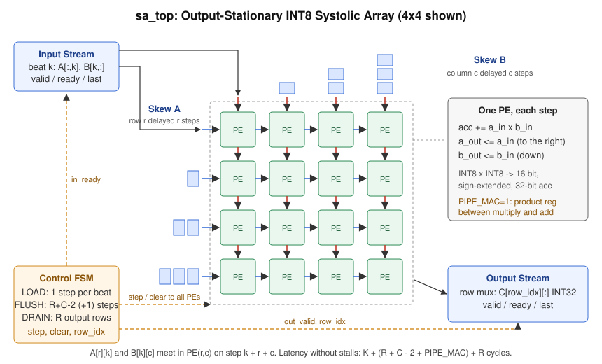

# INT8 Systolic Array Matrix Engine

A parameterized INT8 matrix-multiply accelerator written in SystemVerilog, built the way a hardware team would build it: RTL, a cycle-accurate C++ model of the same design, a UVM-style testbench that checks the two against each other on every clock cycle, formal proofs of the control logic, synthesis onto the SkyWater SKY130 standard cells, and an architecture study of how well the array serves a real transformer workload.

The core is the same idea behind Google's TPU and the matrix units in modern GPUs: a grid of multiply-accumulate units where operands flow between neighbours instead of going back to memory.



## Results at a Glance

| Area | Result |
|---|---|
| RTL | Output-stationary R x C array, any shape from 1x1 up, valid/ready streaming interface, stall-safe on both sides, optional pipelined MAC (`PIPE_MAC`) |
| C++ model | Register-for-register model of the RTL; Also the golden reference and the engine behind the performance study |
| Simulation | 9 array configurations (1x1 to 16x16), 2,808 matrix jobs, 200,000+ cycles where every output was compared with the C++ model, 0 mismatches, 100 % functional coverage ([details](docs/regression_results.md)) |
| Bug detection | 9 of 9 injected RTL bugs caught by the testbench, plus 1 mutant shown to be logically equivalent ([details](docs/mutation_results.md)) |
| Formal | 11 control and datapath assertions proven for all reachable states (k-induction) across 9 configurations |
| Synthesis (SKY130) | 8x8 array: 0.45 mm², 2.38 ns logic delay with the pipelined MAC, down from 3.65 ns ([details](docs/synth_results.md)) |
| Architecture study | On one GPT-2 small block the built design reaches 94.5 % utilization on a 16x16 array for prefill; Decode is capped near 1/R regardless of dataflow ([details](docs/perf_results.md)) |

## How the Array Works

`C (R x C, INT32) = A (R x K) * B (K x C)`, with signed INT8 operands.

Each processing element (PE) owns one output element `C[r][c]`. Every step it multiplies the operand arriving from the left with the one arriving from above, adds the product to its 32-bit accumulator, and passes both operands on (right and down). Because the outputs stay in place this is called output-stationary.

For the right pairs to meet, the inputs are skewed: row `r` of A is delayed by `r` steps and column `c` of B by `c` steps, using small shift registers at the array edges. With that skew, `A[r][k]` and `B[k][c]` arrive at `PE(r,c)` together on step `k + r + c`, so after the last input beat the array needs `R + C - 2` more steps for the final operands to reach the bottom-right PE.

A three-state controller runs each job:

| Phase | What happens | Cycles (no stalls) |
|---|---|---|
| LOAD | Accept one input beat per cycle (column k of A and row k of B); Each accepted beat advances the array one step | K |
| FLUSH | Feed zeros so the last operands travel to the far corner | R + C - 2 (+1 with `PIPE_MAC`) |
| DRAIN | Stream out one row of C per cycle; Clear the accumulators as the last row leaves | R |

So a job takes `K + (R + C - 2 + PIPE_MAC) + R` cycles. The C++ model reproduces this number exactly and the testbench checks it on every directed job.

**Stalls.** If the input side has no data (`in_valid` low) the entire array freezes for that cycle, including the skew registers, which keeps the diagonal wavefront aligned. If the output side applies backpressure (`out_ready` low) the current row is held stable until it is accepted. Both are exercised heavily in random testing.

### Interface

| Port | Direction | Meaning |
|---|---|---|
| `in_valid`, `in_ready`, `in_last` | in, out, in | Input handshake; `in_last` marks beat K-1 |
| `in_a[R*8-1:0]` | in | Column k of A, element r at bits `[r*8 +: 8]` |
| `in_b[C*8-1:0]` | in | Row k of B, element c at bits `[c*8 +: 8]` |
| `out_valid`, `out_ready`, `out_last` | out, in, out | Output handshake; `out_last` marks row R-1 |
| `out_row[C*32-1:0]` | out | Row of C, element c at bits `[c*32 +: 32]` |

Parameters: `ROWS`, `COLS`, `DW` (8), `ACC_W` (32), `PIPE_MAC` (0 or 1). A 32-bit accumulator cannot overflow for K below 131 072 (the worst case product is -128 x -128 = 16 384).

### Pipelined MAC

With `PIPE_MAC = 1` each PE gets a register between the multiplier and the adder, so the multiply and the 32-bit add happen in different cycles. The operand flow through the array does not change; The controller only adds one flush step to empty the product registers. The synthesis section shows what this buys.

## Verification

```
                    +----------------------- SaEnv ------------------------+
 DirectedSeq /      |  InAgent                               OutAgent      |
 RandomSeq  ------> |  sequencer -> InDriver ---+    +--- OutReadyDriver   |
                    |               (bubbles)   |    |    (backpressure)   |
                    |                          DUT: sa_top                 |
                    |  InMonitor <--------------+    +---> OutMonitor      |
                    |     |  |                                  |          |
                    |     |  +--> Coverage                      |          |
                    |     +-----> Scoreboard (NumPy) <----------+          |
                    |                                                      |
                    |  LockstepChecker: C++ model, compared every cycle    |
                    +------------------------------------------------------+
```

The testbench is written in Python with [pyuvm](https://github.com/pyuvm/pyuvm) (the UVM class library on top of cocotb) and runs on Icarus Verilog. Four independent checks are active in every test:

1. **Scoreboard.** Rebuilds A and B from the beats the DUT actually accepted, computes the expected result with NumPy (32-bit wrapping arithmetic), and compares it with the rows the DUT produced, job by job.
2. **Lockstep against the C++ model.** The C++ model is compiled to a shared library and loaded with `ctypes`. On every rising edge the checker compares all DUT outputs with the model, then ticks the model with the same inputs the DUT sampled. This checks timing, not just answers: every stall, every handshake and the accumulator contents seen through the output mux must match cycle for cycle.
3. **RTL assertions.** Under `SA_CHECKS_ON` the RTL checks its own invariants (legal FSM state, counters in range, input and output phases never overlap, output held stable under backpressure, accumulators zero after clear). The test fails if any fires.
4. **Functional coverage.** Bins for the shape of K (1, below R, medium, long), operand corners (-128 x -128, 127 x 127, -128 x 127, all zeros), input bubbles inside a job, output backpressure, back-to-back jobs, and crosses of these. The random test must close coverage to pass.

Tests:

| Test | What it does |
|---|---|
| `DirectedTest` | Hand-picked corner cases with no stalls; Also checks the exact latency formula |
| `RandomStallTest` | 300 constrained-random jobs, about 25 % input bubbles (with garbage on the data lines while invalid) and 30 % output backpressure |
| `reset_mid_job` | Asynchronous reset in the middle of LOAD, FLUSH and DRAIN; The next job must come out correct |

Regression results are in [docs/regression_results.md](docs/regression_results.md).

### Does the Testbench Catch Bugs?

A testbench that passes on correct RTL proves little by itself. `scripts/mutation_test.py` copies the RTL, injects one realistic bug at a time, reruns the tests and records which checker caught it:

| Injected bug | Caught by |
|---|---|
| Sign extension of the product dropped | Scoreboard, lockstep |
| Operands multiplied as unsigned | Scoreboard, lockstep |
| PEs keep advancing while stalled | Scoreboard, lockstep |
| Flush one step too short | Scoreboard, lockstep |
| Wrong tap in the input skew registers | Scoreboard, lockstep |
| Accumulators not cleared between jobs | Scoreboard, lockstep |
| Output rows advance without a handshake | Lockstep, assertion |
| Input accepted during FLUSH | Scoreboard, lockstep |
| Pipelined MAC: missing extra flush step | Scoreboard, lockstep |
| Pipelined MAC: product register not cleared | Equivalent mutant (see below) |

Two observations came out of this. First, the handshake bug slips past the scoreboard (the monitor only samples accepted rows, so the numbers look right) but the assertions and the lockstep model both flag it, which is the reason for having more than one kind of check. Second, the last mutant survived every test. Working through why showed that it cannot change any output: on the final flush step every PE is multiplying zeros, because the last real operands have already moved past it, so the product register is already zero when `clear` fires. The clear is redundant in normal operation and stays only as a safety net.

### Formal Proof

`formal/run_formal.sh` reads the RTL with Yosys in formal mode and proves the 11 assertions with SAT-based k-induction, starting from the reset state. Unlike simulation this covers every possible input sequence, not just the ones the random tests happened to generate. All configurations prove at induction length 2:

```
1x1 PIPE_MAC=0: PROVEN  (11 assertions, induction length 2)
2x2 PIPE_MAC=1: PROVEN  (11 assertions, induction length 2)
4x4 PIPE_MAC=1: PROVEN  (11 assertions, induction length 2)
...
```

As a sanity check, the same flow run on the handshake mutant finds a counterexample.

## Synthesis

Synthesized with Yosys and ABC onto the SKY130 HD standard cell library (typical corner, 25 °C, 1.8 V). Delays are register-to-register logic delay reported by ABC, without clock-to-Q, setup or wire parasitics; The fmax column adds a rough 0.5 ns for the flip-flops and is an estimate, not a signoff number.

| Array | PIPE_MAC | ABC mapping | Area (mm²) | Flip-flops | Logic delay (ns) | Est. fmax (MHz) | Critical path starts at |
|---|---|---|---:|---:|---:|---:|---|
| 4x4 | 0 | area | 0.085 | 807 | 7.73 | 121 | FSM state |
| 4x4 | 1 | area | 0.090 | 1063 | 6.48 | 143 | PE accumulator |
| 4x4 | 0 | delay, 1 ns target | 0.107 | 807 | 3.64 | 241 | PE operand register |
| 4x4 | 1 | delay, 1 ns target | 0.112 | 1063 | 2.38 | 347 | FSM state |
| 8x8 | 0 | delay, 1 ns target | 0.433 | 3401 | 3.65 | 241 | PE operand register |
| 8x8 | 1 | delay, 1 ns target | 0.453 | 4425 | 2.38 | 347 | PE operand register |

How the critical path moved:

1. **Area-oriented mapping** collapsed the 32-bit accumulator adder into a ripple-carry chain (a long string of `maj3` cells in the timing report), so every PE needed over 6 ns.
2. **Delay-oriented mapping** rebuilt the adder with a faster carry structure and cut the delay in half. The critical path became operand register, 8x8 multiplier, 32-bit adder, accumulator.
3. **Pipelining the MAC** split that path in two: 3.65 ns down to 2.38 ns (35 % lower logic delay) for about 5 % more area on the 8x8 array, at the cost of one extra cycle per job.
4. After pipelining, the multiplier and the `step` enable (one FSM signal that fans out to every flip-flop in the array) are nearly tied for the critical path. The next step would be to buffer or replicate the enable, which matters more as the array grows and real wire delay appears.

Reproduce with `make synth` (fetches the liberty file on first run).

## Architecture Study: How Well Does the Array Serve a Transformer?

`model/perf_model.cpp` maps every matrix multiply in one GPT-2 small block (d_model 768, 12 heads of 64, FFN 3072) onto arrays from 8x8 to 64x64. The "OS-built" numbers come from running the cycle-accurate model of this exact design; The other two columns are analytical models of common improvements:

* **OS-built**: this RTL; Tiles run back to back with no overlap.
* **OS-dbuf**: output-stationary with double-buffered accumulators, so draining one tile hides under the next.
* **WS-dbuf**: weight-stationary (B held in the array, A streamed through) with double-buffered weights.

Utilization means useful MACs divided by (cycles x number of PEs). Traffic is bytes moved between the on-chip buffers and the array edges.

| Phase | Array | OS-built util | OS-dbuf util | WS-dbuf util | OS traffic (MB) | WS traffic (MB) |
|---|---|---:|---:|---:|---:|---:|
| Prefill, 128 tokens | 8x8 | 97.3 % | 100.0 % | 100.0 % | 237.5 | 1050.1 |
| Prefill, 128 tokens | 16x16 | 94.5 % | 100.0 % | 100.0 % | 121.1 | 526.3 |
| Prefill, 128 tokens | 32x32 | 89.4 % | 99.7 % | 99.7 % | 62.9 | 264.4 |
| Prefill, 128 tokens | 64x64 | 80.6 % | 97.7 % | 97.7 % | 33.8 | 133.5 |
| Decode, 512-token cache | 16x16 | 5.8 % | 6.2 % | 6.2 % | 8.4 | 12.2 |
| Decode, 512-token cache | 64x64 | 1.2 % | 1.5 % | 1.5 % | 8.0 | 8.9 |

What the numbers say:

1. **Fill and drain overhead grows with array size.** The built design loses 5.5 % at 16x16 but almost 20 % at 64x64, because every tile pays `R + C - 2` flush cycles and `R` drain cycles. The attention score GEMM (`Q x K^T`, K = 64 per head) is the worst case: only 58 % utilization on 16x16, since a short K cannot amortize the overhead. Double-buffering the accumulators recovers this to about 99 %, which makes it the clear next design change.
2. **Decode is a different problem.** Generating one token is a matrix-vector product (M = 1), so only one row of the array does useful work. Utilization is stuck near 1/R for both dataflows, and a bigger array makes it worse. More compute does not help here; Batching requests or a vector unit does.
3. **Dataflow choice is about data movement, not speed.** With ideal overlap both dataflows reach the same utilization, but under this buffer model output-stationary moves about 4x less data during prefill, because weight-stationary has to write out and read back partial sums for every K tile. Weight-stationary only wins on traffic when the partial sums can stay local.

Full per-layer tables: [docs/perf_results.md](docs/perf_results.md).

## Repository Layout

```
rtl/
  pe.sv               processing element (MAC + operand pass-through, optional product register)
  systolic_array.sv   R x C grid of PEs
  sa_top.sv           skew registers, control FSM, output mux, assertions
model/
  sa_model.hpp/.cpp   cycle-accurate model + C interface for the testbench
  selftest.cpp        checks the model against a plain matmul before it is trusted
  perf_model.cpp      transformer dataflow study
tb/
  test_sa_top.py      pyuvm environment and tests
  model_bridge.py     ctypes bridge to the C++ model
  run_regression.py   builds and runs the tests for each configuration
formal/run_formal.sh  k-induction proof of the assertions
synth/run_synth.sh    Yosys + ABC synthesis onto SKY130
scripts/              mutation testing and report generators
docs/                 diagram and generated result tables
```

## How to Run

Requirements: Icarus Verilog 12+, Verilator 5 (lint only), Yosys 0.33+, a C++17 compiler, Python 3.10+.

```bash
pip install -r requirements.txt
make model      # build and self-test the C++ model
make lint       # Verilator lint across configurations
make test       # quick regression (4x4, plain and pipelined)
make regress    # full regression
make mutate     # mutation testing
make formal     # formal proof
make synth      # SKY130 synthesis
make perf       # transformer dataflow study
```

Run one configuration by hand: `python3 tb/run_regression.py --sizes 8x8p --jobs 500 --seed 7`.

## Limitations

* Synthesis numbers are pre-layout: no place and route, no wire parasitics, typical corner only.
* One job at a time; There is no overlap between draining one result and loading the next (the study above quantifies what that costs).
* No on-chip operand buffers or tiling controller; The array expects tiles to be streamed in by something upstream.
* The dataflow study models buffer traffic, not DRAM bandwidth or energy.

## Next Steps

* Double-buffered accumulators so drain overlaps the next job (the biggest win per the study).
* Register or replicate the `step` enable to take it off the critical path.
* Place and route the 8x8 array with OpenLane for post-layout timing and power.
